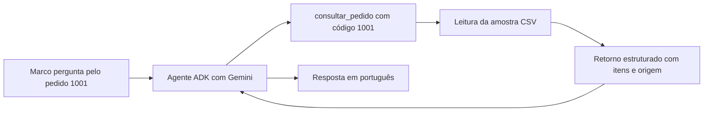

# Como o assistente TransLog foi construído

Registro de 14/11/2026 para Marco estudar e preparar a apresentação. Descreve o que existe hoje; não declara a entrega final concluída.

## Resposta direta

Existe um agente Google ADK em Python, com duas ferramentas e conversação em português. Marco já o utilizou com Gemini para consultar uma **amostra inteiramente fictícia**, identificada como histórica/simulada. **Os 30 testes automatizados e essas conversas não usaram a Silver recebida de Matheus de Dados.** A Silver foi inspecionada e auditada em uma atividade separada.

A estrutura de recuperação vetorial com Chroma está implementada e foi testada com conteúdo controlado. Isso não significa que as consultas de status apresentadas no chat tenham usado RAG. Elas usaram consulta exata ao CSV de amostra. O conector SQL ainda não foi implementado.

## 1. O papel de cada componente

| Componente | Explicação simples | Onde aparece no projeto |
| --- | --- | --- |
| Python | Linguagem em que escrevemos as funções e configurações | `src/translog/` |
| Google ADK | Biblioteca que organiza o agente, as chamadas ao modelo, as ferramentas e a conversa | `agent_factory.py` e entrada em `agents/translog_agent/` |
| Gemini | Modelo de linguagem que interpreta a pergunta e produz a resposta | Modelo selecionado por `GEMINI_MODEL` |
| Ferramenta de pedido | Função que procura o código na fonte estruturada e retorna todos os seus itens | `consultar_pedido` em `tools.py`; consulta em `orders.py` |
| Ferramenta de conhecimento | Função que procura trechos de FAQ e políticas no índice Chroma | `buscar_faq_e_politicas` em `tools.py`; busca em `knowledge.py` |
| ADK Web | Tela local de desenvolvimento usada para conversar e inspecionar eventos | Comando `adk web` |

O agente foi criado **com a biblioteca do Google ADK, no projeto local**. Não foi necessário criar um agente em uma tela do Google Cloud nem publicar uma aplicação na nuvem. A execução do aplicativo é local; nas conversas reais, o modelo Gemini é acessado por API. Não houve treinamento nem ajuste dos pesos de um modelo com os dados da TransLog.

## 2. Como o código cria o agente

Em `src/translog/agent_factory.py`, a função `create_agent` reúne quatro elementos:

1. **Nome:** `translog_agent`, que identifica o assistente na interface.
2. **Modelo:** lido da configuração. Marco informou uso bem-sucedido de `gemini-3.5-flash-lite`, após indisponibilidade do modelo inicialmente proposto. Essa escolha privada não foi copiada junto com a `.env` para o repositório do grupo; outra instalação precisa conferir seu próprio modelo e acesso.
3. **Instruções:** responder em português, consultar a fonte antes de afirmar status, pedir código quando ausente, preservar todos os itens, distinguir desconhecido de zero e reconhecer falhas. Também proíbem inventar GPS, causas, previsões ou políticas.
4. **Ferramentas:** `consultar_pedido` e `buscar_faq_e_politicas`, funções Python registradas na lista `tools`.

O trecho central é:

```python
return Agent(
    name="translog_agent",
    model=model if model is not None else settings.model,
    description="Consulta de pedidos e orientações de entrega baseadas em fontes.",
    instruction=INSTRUCTION,
    tools=[consultar_pedido, buscar_faq_e_politicas],
)
```

Em `agents/translog_agent/agent.py`, `root_agent = create_agent()` disponibiliza esse objeto como entrada do agente. O comando `adk web agents --port 8001 --no_use_local_storage` carrega a aplicação e abre o servidor de desenvolvimento. Nesse modo, reiniciar o servidor perde as conversas em memória.

As descrições e os argumentos das funções ajudam o modelo a escolher uma ferramenta. O modelo solicita a chamada; o ADK executa a função Python e devolve seu resultado ao fluxo da conversa. A resposta final é produzida a partir desse retorno. Esse mecanismo é consistente com a [documentação oficial de agentes LLM do ADK](https://github.com/google/adk-docs/blob/main/docs/agents/llm-agents.md); o comportamento específico acima foi conferido no código deste projeto.

## 3. O que aconteceu na consulta ao pedido 1001



A ferramenta encontrou o item 1 do pedido 1001: status `COMPLETE`, entrega `Late delivery`, 4 dias previstos, 6 registrados e 2 de atraso. O retorno incluiu `backend=csv`, `origin=sample`, `is_simulated=true` e `is_historical=true`. Marco apresentou esse evento no chat e ele foi conferido.

Na implementação atual, a função Python calcula o atraso da amostra com `max(actual_days - scheduled_days, 0)` quando os dois valores existem. O modelo recebe o resultado já estruturado; a conta não precisa ficar a cargo da geração de texto. O retorno seleciona campos necessários dos itens encontrados, sem entregar o CSV completo ao modelo.

O termo **autônomo**, neste protótipo, significa que o agente pode escolher e solicitar ferramentas durante o atendimento, sem o usuário chamar cada função manualmente. A evidência apresentada comprova a consulta do 1001, não a correção de toda decisão futura do modelo. Não há monitoramento contínuo, reagendamento, alteração de cadastro ou escrita em banco.

## 4. Onde entra o RAG com Chroma

RAG é recuperar informações de uma fonte para apoiar a resposta do modelo. No projeto, a parte **vetorial** está destinada a FAQ e políticas, enquanto o pedido é localizado por seu código exato.

O caminho de conhecimento implementado é:

1. Receber textos JSON com título, conteúdo, tipo, fonte, versão e estado de revisão.
2. Gerar embeddings, representações numéricas dos textos. A implementação padrão utiliza `ONNXMiniLM_L6_V2` localmente, separado do Gemini que redige a resposta.
3. Armazenar textos, vetores e metadados em uma coleção persistente Chroma.
4. Na pergunta sobre uma regra, a ferramenta consultar o índice e devolver até três trechos candidatos por semelhança.
5. O agente usar apenas os trechos que sustentarem a orientação e citar sua fonte; ausência ou contradição precisa ser reconhecida.

Exemplo de pergunta que usa esse caminho: “Qual é a regra para mudar o endereço?”. Uma pergunta mista, como “1001 atrasou; o que devo fazer?”, pode exigir as duas ferramentas.

Conteúdo demonstrativo e conteúdo revisado têm índices ativos separados. Um documento marcado como revisado exige `approved_by` preenchido, mas o campo por si só não comprova aprovação externa: os dados dos testes também são artificiais. O modo demo precisa ser habilitado explicitamente.

**Limite atual:** o diagnóstico anterior registrou modo revisado sem índice disponível. Na conferência desta documentação, não existia ponteiro de índice revisado em `.state/chroma/active-approved.json` em nenhuma das duas pastas. A pasta original tinha um índice demo; a cópia integrada não tinha índices copiados, como esperado para arquivos derivados ignorados. Não foi feita nova inferência nem ativado o modo demo nesta revisão.

Os quatro cenários manuais apresentados foram de pedidos ou identificação. Não demonstram uma conversa completa com recuperação Chroma e Gemini. Os textos de FAQ e políticas oficiais continuam pendentes.

## 5. Quais dados foram usados nos testes

| Verificação | Dados e componentes usados | O que demonstra | O que ainda não demonstra |
| --- | --- | --- | --- |
| Consulta de pedidos | `data/samples/orders.csv`, com sete itens de seis pedidos fictícios, e arquivos temporários artificiais | Consulta, múltiplos itens, zeros à esquerda, nulos, entradas inválidas e fonte indisponível | Consulta correta à exportação real da Silver |
| API ADK | API e ferramenta reais, CSV fictício e `DeterministicModel`, um modelo de teste sem rede | Eventos, chamada da ferramenta, extração do texto final e separação de conversas | Qualidade de resposta do Gemini ou integração com o portal |
| Chroma na suíte | Chroma real, textos criados pelo teste e `TinyEmbeddings`, embeddings determinísticos de teste | Persistência, revisões, retirada de textos, validação e separação demo/revisado | Qualidade semântica do modelo de embeddings padrão em uso final |
| CLI e cliente | Configurações controladas e eventos artificiais | Diagnóstico sem expor chave e tratamento de respostas incompletas/erros | Teste de cota do Gemini ou funcionamento completo do portal |
| Conversas manuais | Gemini informado por Marco e amostra fictícia | Respostas observadas nos cenários 1001, 1004, 9999 e pergunta sem código | Dez conversas aprovadas, Silver no agente ou RAG conversacional completo |
| Auditoria da Silver | Exportação recebida de Matheus de Dados, analisada localmente | Estrutura, contagens e regras observadas na exportação | Adaptação do agente, aprovação do significado das colunas ou validação do pipeline Bronze |

O teste `test_canonical_mapping_and_encoding_select_only_allowed_fields` cria um arquivo temporário chamado `silver.csv` e define `origin="silver"`. **Esse arquivo é fabricado pelo teste, não é a Silver recebida de Matheus.** Seu objetivo é verificar o mapeamento de nomes e impedir que campos pessoais entrem no retorno.

Há registro histórico separado de busca com embeddings reais locais em oito textos demonstrativos: três perguntas recuperaram o item esperado entre os três candidatos. Essa verificação não integra a evidência das quatro conversas manuais recentes e não usa políticas oficiais.

Na integração, Marco apresentou primeiro 18 testes aprovados e 12 erros de preparação porque a pasta `.cache` não existia. Após criá-la, apresentou **30 passed, 9 warnings in 4.80s**. Foi reutilizado o ambiente Python da pasta original, com o `src` do destino priorizado. Isso ainda não comprova uma instalação independente na máquina de Matheus FullStack. A configuração do script de preparação já cria `.cache/tmp`.

Nenhuma suíte ou chamada Gemini foi reexecutada para escrever este documento. A revisão comparou os 14 arquivos Python de código/entrada/testes entre a pasta original e a integrada, sem diferenças além de espaços/quebras finais.

## 6. Por que a Silver ainda não foi ligada ao agente

A exportação recebida contém 180.519 itens de 65.752 pedidos, em 41 colunas. A auditoria foi registrada em [revisao-silver-2026-11-14.md](revisao-silver-2026-11-14.md).

Não basta trocar o caminho do CSV. A Silver possui `dias_atraso` com sinal e 79.510 valores ausentes em grupos não avaliados/cancelados. A regra atual da amostra recalcula atraso não negativo sempre que os dois dias existem; aplicada indiscriminadamente, mudaria o significado desses registros. Também precisam ser conferidos status, significado dos dias e versão mais recente da exportação com Matheus de Dados.

Portanto, a situação correta é: **Silver recebida e auditada; adaptação e testes do agente com a Silver ainda pendentes.** Os dados são históricos; suas coordenadas não comprovam GPS de veículos, e o atraso não comprova a causa.

## 7. A entrega atende ao pedido de Marco?

Texto reapresentado por Marco:

> Agente autônomo para responder status de rastreio de pacotes em linguagem natural com RAG vetorial usando Chroma ou via agente que realiza SQL usando ADK.

**A implementação está na direção da entrega, mas a conclusão ainda é parcial.**

| Parte do pedido | Situação verificável |
| --- | --- |
| Agente usando Google ADK | Implementado em Python com `Agent` e `root_agent` |
| Atendimento em linguagem natural | Exercitado com Gemini na amostra, conforme respostas apresentadas por Marco |
| Escolha de ferramenta durante a conversa | Evento de retorno de `consultar_pedido` apresentado para 1001; avaliação ampla ainda pendente |
| Rastreio fundamentado nos dados do projeto | Consulta fictícia funciona; uso da Silver no agente ainda pendente |
| RAG vetorial usando Chroma | Estrutura implementada e testes técnicos registrados; conteúdo revisado e avaliação conversacional final ainda pendentes |
| Consulta SQL | Não implementada; `PendingSqlRepository` informa indisponibilidade e não executa SQL |
| Integração com portal | Contrato local inicial e cliente de exemplo existem; validação conjunta ainda pendente |

Na leitura do texto isolado, **“ou” oferece alternativas**; ele não obriga, sozinho, a implementar Chroma e SQL simultaneamente. Nos acordos locais mais detalhados, registrados em `Agentes.md` e `plano-projeto.md`, foi previsto combinar consulta estruturada com Chroma para FAQ/políticas e concluir o conector após a escolha do banco. Esta explicação não muda esses acordos nem escolhe o banco pelo grupo.

Hoje, a presença de Chroma para FAQ não comprova que o rastreio esteja apoiado em RAG vetorial com o dataset; a consulta CSV também não é SQL. Para concluir, será necessário validar a fonte e sua semântica, implementar/confirmar o caminho de consulta acordado e demonstrar o fluxo com dados conferidos e avaliações registradas. Não é necessário inventar causas de atraso para atender ao status de rastreio.

O repositório único já recebeu a base em `agent/` por meio do [PR #30, criado como rascunho](https://github.com/stephanielopes-ipnet/translog-logistica/pull/30), commit `7e54bf1`. A criação do PR e sua verificação são registros deste acompanhamento; não equivalem a aprovação ou merge.

## 8. Explicação curta para a apresentação

> Construí a base do assistente em Python com apoio de uma ferramenta de desenvolvimento e usei o Google ADK para conectar o modelo Gemini às funções de consulta. Defini duas ferramentas: uma procura todos os itens de um pedido pelo código, e outra recupera FAQ e políticas no Chroma. O modelo interpreta a pergunta e transforma o resultado das ferramentas em uma resposta em português. Primeiro validei a estrutura com uma amostra fictícia e testes automatizados; depois testei conversas reais com Gemini e conferi o retorno de uma ferramenta. A Silver recebida de Dados foi auditada separadamente e ainda precisa ser adaptada ao agente. A versão atual é um protótipo de consulta, com integração ao portal e validações finais pendentes.

Na apresentação final, atualizar essa fala com as entregas realizadas depois de 14/11. Não afirmar que houve treinamento com a Silver, SQL executado, RAG usado no status ou dez conversas aprovadas sem a evidência correspondente.

## 9. Próxima etapa do acompanhamento

Retomar a documentação de API para Matheus FullStack e a validação de reprodução no destino. Em paralelo ao trabalho independente, alinhar com Matheus de Dados o dicionário, a exportação atual e as regras de atraso; com o grupo, banco e fonte final; e com Stephanie, FAQ/políticas revisadas. Seguir uma etapa pequena por vez, sem repetir configuração da chave ou clonagem.

Referências locais: [contrato de dados](contrato-dados.md), [API](api-chat.md), [avaliação](avaliacao.md), [estado da implementação](status-implementacao.md) e [retomada](retomada-marco.md).
